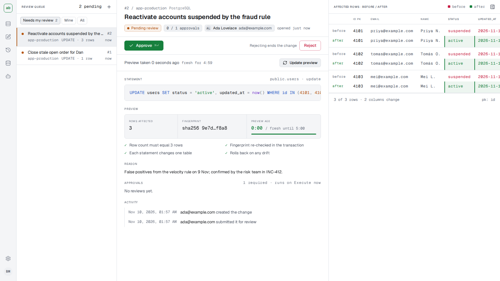

<p align="center">
  
</p>

<h1 align="center">dbairlock</h1>

<p align="center">Reviewed, audited data changes for production databases, for engineers and their AI agents.</p>

<p align="center">
  <a href="docs/self-hosting.md">Self-hosting</a> ·
  <a href="docs/agents.md">Connect an agent</a> ·
  <a href="docs/security.md">Security</a> ·
  <a href="LICENSE">MIT license</a>
</p>

Instead of running `UPDATE` statements by hand against production, an engineer or an agent submits the change to dbairlock. A teammate reviews it in a web dashboard, seeing the before and after image of every row it will touch, and dbairlock then executes it, rolling it back if the rows have drifted since the review. Nobody on the team needs write credentials.



## What it does

- **Review exact rows, not code.** Every change is dry-run on the target in a rolled-back transaction. The reviewer sees the affected rows before and after, and an approval needs a preview taken in the last 5 minutes.
- **Guarded execution.** At run time the matching rows are locked and fingerprinted again. If different rows match, the values about to be overwritten have changed, or the row count differs, the whole change is rolled back and nothing is changed.
- **Agents propose, humans approve.** AI agents connect over MCP at `/mcp`, read the schema, check SQL and submit changes. They sign in through the browser with OAuth (`claude mcp login`), or use an API token in CI. They never see row data and cannot approve anything. The author of a change can never approve it.
- **Row changes only.** Single-table `INSERT`, `UPDATE` and `DELETE`. No DDL, no `SELECT`, no `UPDATE` or `DELETE` without a `WHERE`. SQL that cannot be parsed is rejected.
- **Ordered statements and sequences.** A change can hold several statements, run top to bottom in one transaction. A sequence links changes across databases (Postgres, then MySQL, then Postgres again): each step is reviewed when the step before it has run, and is atomic on its own database. Steps already run are never undone silently; a stopped sequence says exactly which ones were applied.
- **Tamper-evident audit log.** Every sign-in, submission, review, execution and setting change is recorded in a hash chain, in the same transaction as the change itself.
- **Postgres and MySQL**, each connection with its own review policy.
- **Self-hosted, configured in the browser.** One container, one volume, no environment variables or config files. Google sign-in, restricted to your Workspace domains.
- **Write-only secrets.** Database passwords, the Google client secret and the webhook URL can be set and replaced, never read back.

## How a change flows

```
author or agent ──submit──▶ dry run (rolled back) ──▶ reviewer sees every row, before and after
                                                         │
                                         approve (preview under 5 min old)
                                                         ▼
                       execute: lock rows, re-check fingerprint ──▶ commit, or roll back on drift
                                                         │
                                       every step lands in the hash-chained audit log
```

## Quick start

You need Docker with Compose and Git. From a terminal:

```sh
git clone https://github.com/alvaroibarguen/dbairlock.git
cd dbairlock
docker compose -f deploy/compose.yml up -d
docker compose -f deploy/compose.yml logs dbairlock
```

The first `up` builds the image from source, which takes a few minutes. The log then shows a setup block:

```
==================== dbairlock setup ====================
  This instance is not set up yet.
  Open:  http://localhost:8080/setup
  Code:  XXXXX-XXXXX-XXXXX-XXXXX
  The code changes every time dbairlock restarts.
=========================================================
```

Open <http://localhost:8080> in your browser, enter the code, and follow the wizard. It asks for a Google OAuth client; [docs/self-hosting.md](docs/self-hosting.md#google-sign-in) shows how to create one in two minutes. The first person to sign in becomes the admin. Databases are added under **Connections**, and everything else (review policy defaults, users, API tokens, notifications) is in **Settings**.

To stop it: `docker compose -f deploy/compose.yml down`. Your data stays in the `dbairlock_dbairlock-data` volume until you remove it with `down -v`.

## Documentation

- [Self-hosting](docs/self-hosting.md): requirements, Google sign-in, network placement, TLS proxy, database users, backups, upgrades and recovery.
- [Connecting AI agents](docs/agents.md): MCP setup for Claude Code and other clients, and what agents can and cannot do.
- [Configuration](docs/configuration.md): every setting, connection field, process flag and fixed limit.
- [Security](docs/security.md): threat model, what the database grant and the dry run do, secrets and the audit chain.
- [Operations](docs/operations.md): the data directory, the master key and its rotation.
- [Architecture](docs/architecture.md): module map, import rules, and adding a connector.
- [Versions](docs/VERSIONS.md): toolchain, dependencies, base images and supported databases.

## Development

Go, cgo (gcc) and pnpm are required; Docker for the integration tests and the sample databases.

| Command                                          | What it does                                                                                       |
| ------------------------------------------------ | -------------------------------------------------------------------------------------------------- |
| `make build`                                     | Builds the dashboard and one binary at `bin/dbairlock`                                             |
| `make dev`                                       | Runs the server (`--dev`: loopback only, a sign-in form instead of Google) and the Vite dev server |
| `docker compose -f deploy/dev/compose.yml up -d` | Starts sample Postgres and MySQL targets                                                           |
| `make test`                                      | Go tests with the race detector                                                                    |
| `make lint`                                      | Go and web linters, formatting and import rules                                                    |
| `make test-all`                                  | Everything, plus Playwright against a race-enabled binary                                          |
| `make image`                                     | Builds the container image                                                                         |
| `make screenshots`                               | Regenerates the review screenshot above                                                            |

The design system is [DESIGN.md](DESIGN.md) and the product rules are [PRODUCT.md](PRODUCT.md). The app icon is [web/public/favicon.svg](web/public/favicon.svg): two airlock doors holding one row between them.

## License

[MIT](LICENSE)
